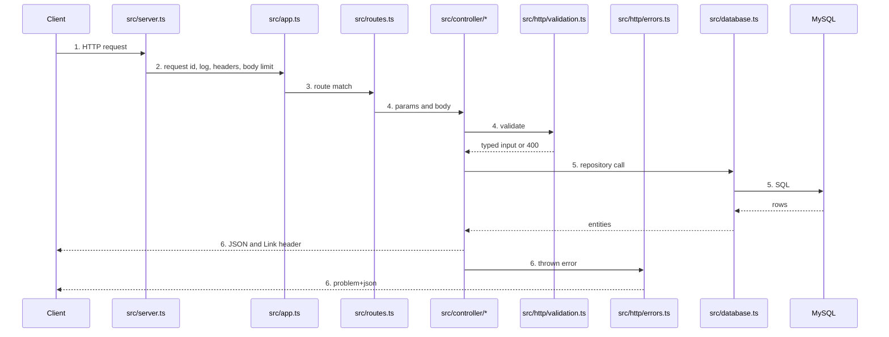
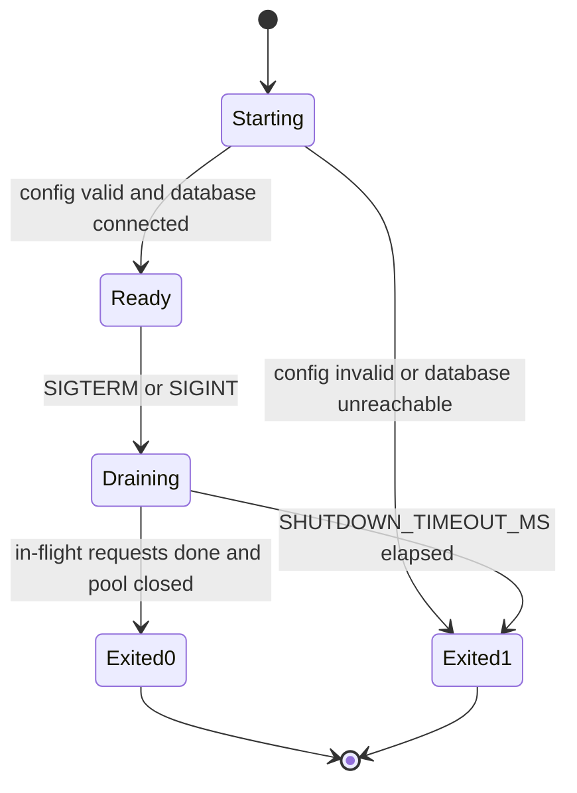
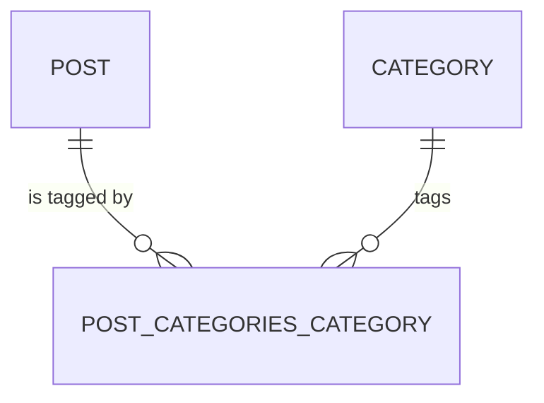

# App hardening

**Approved**: 2026-10-29 - user: "plano aprovado, pode proceder com a implementação"

## Problem

The application is built for a developer laptop, and running it as-is in a 24/7, multi-zone
deployment fails in ways an operator pays for:

- The schema is changed by `TYPEORM_SYNCHRONIZE=true` at every boot, and no migration exists, so
  the schema in production is whatever the last booted replica decided.
- When the database is unreachable at boot the error is logged and the process stays alive
  without listening, so an orchestrator never restarts it.
- There is no liveness or readiness signal and SIGTERM kills in-flight requests, so every
  rollout and every node drain drops traffic.
- `POST /posts` stores the raw body: a client that sends `id` overwrites someone else's post, and
  any size of payload is accepted. `GET /posts` returns the whole table in one response.
- Unhandled errors return Express's default HTML page, with the stack trace outside production.
- TypeScript is compiled inside the `start` script, into `src/`; the package manager is Yarn 1,
  frozen upstream; the toolchain (TypeScript 3.3,
  TypeORM 0.2, `@types/node` 9, MariaDB 5.5) is years out of support.
- Logs are free-text `console.log`, there are no metrics, no tests and no lint.

Evidence: `README.md` states the code "is written in a way to make local development easier,
which makes for bad practices when running it in a remote environment"; the items above are read
from `src/index.ts`, `src/controller/*`, `package.json`, `tsconfig.json` and
`ormconfig.env.example`.

When this ships, an operator can run N replicas of the service against MySQL 8.4 with the schema
owned by versioned migrations, the orchestrator can tell when a replica is alive, ready or
draining, a rollout drops no request, and a client gets a bounded, validated, documented API with
machine-readable errors.

## Shape

This keeps the three existing endpoints, their controllers and both entities, and replaces only
what is around them (bootstrap, configuration, driver, error handling). The rules that change an
outcome - configuration parsing, request validation, pagination and error mapping - run in plain
modules that the Vitest suite calls directly, and the HTTP behaviour is proven through the Express
app factory with Supertest against a real MySQL 8.4 started by Testcontainers.

1. in: HTTP request -> `src/server.ts` (new) - Node HTTP server with timeouts, owns the process
   lifecycle (boot, SIGTERM drain) and hands the request to the app
2. `src/app.ts` (new) - Express 5 app factory: request id, access log, security headers, JSON body
   limit, `/healthz`, `/readyz`, `/metrics`, then the routes
3. `src/routes.ts` (exists) - maps `GET /posts`, `GET /posts/:id`, `POST /posts` to the controllers
4. `src/controller/*` (exists) - validate params and body with `src/http/validation.ts` (new), call
   the repositories of `src/data-source.ts` (new)
5. `src/database.ts` (new) - TypeORM 1.1 `DataSource` on `mysql2`, built from `src/config.ts` (new);
   `src/data-source.ts` (new) wraps it for the migration CLI; persists `Post` and `Category` in the schema of door 1
6. out: JSON body, or `application/problem+json` from `src/http/errors.ts` (new) (door 2); next page
   in the `Link` header (door 3)

Process lifecycle, owned by `src/server.ts`:

**Changes underneath**

| Front | What changes |
| --- | --- |
| domain | The database engine stays MySQL, upgraded from MariaDB 5.5 to MySQL 8.4 LTS, and the driver from `mysql` to `mysql2` (AD-001); nothing branches on the engine outside `src/database.ts` |
| stored data | nothing to migrate - no environment holds data; the first migration creates the schema from empty |
| readers | API clients: `GET /posts` returns at most 20 posts by default, and both reads now include `categories`; `POST /posts` answers 201; errors become problem+json. `README.md` run instructions are rewritten |

New: nothing - the same two entities and join table, now created by a migration instead of
`synchronize`. One-way constraints: `post.id` and `category.id` are 32-bit identities (door 1).

## Surface

| Route | In | Out | Status | Who |
| --- | --- | --- | --- | --- |
| `GET /posts` | query `limit` (1-100, default 20), `after` (post id, optional) | JSON array of posts with `categories`; `Link: <...>; rel="next"` when more exist | `200`, `400` | anyone - authentication is out of scope |
| `GET /posts/:id` | path `id` (1-2147483647) | post with `categories` | `200`, `400`, `404` | anyone |
| `POST /posts` | JSON `title`, `text`, `categories[].name` | stored post with ids; `Location` header | `201`, `400`, `413`, `415` | anyone - authentication is out of scope |
| `GET /healthz` | - | `{"status":"ok"}` | `200` | anyone - kept off the public route by the ingress (feature `helm-chart`) |
| `GET /readyz` | - | `{"status":"ok"}` or problem+json | `200`, `503` | anyone - kept off the public route by the ingress |
| `GET /metrics` | - | Prometheus text format | `200` | anyone - kept off the public route by the ingress |

## Landing

| One-way door | Literal shape | Alternative rejected |
| --- | --- | --- |
| 1. MySQL schema, created by migration `InitialSchema` (AD-001) | InnoDB, `utf8mb4`: `post(id int AUTO_INCREMENT PK, title varchar(255) NOT NULL, text text NOT NULL)`, `category(id int AUTO_INCREMENT PK, name varchar(100) NOT NULL)`, `post_categories_category(postId int FK ON DELETE CASCADE, categoryId int FK ON DELETE CASCADE, PK(postId, categoryId))` with an index on `categoryId`; TypeORM default names kept; migrations table `migrations` | `bigint`/`uuid` ids: `mysql2` returns `bigint` as a string, changing the JSON type of `id` that clients bind to; 2^31 posts is far beyond this service's horizon and the column can be widened by a later migration |
| 2. Error contract | RFC 9457, `Content-Type: application/problem+json`, body `{"type":"about:blank","title":"Bad Request","status":400,"detail":"...","errors":[{"field":"title","message":"..."}]}`; `errors` only on 400 | ad-hoc `{"error":"..."}`: no standard, so every client writes its own parser per endpoint |
| 3. Pagination contract | keyset: `GET /posts?limit=20&after=<last id>`, ordered by `id` ascending; body stays a bare JSON array; next page in `Link: </posts?limit=20&after=20>; rel="next"`, absent on the last page | offset pagination: cost grows with the offset and pages skip or repeat rows under concurrent inserts; an envelope `{data,next}`: breaks every client that parses today's array |
| 4. Runtime and toolchain | Node.js 24 LTS (`engines.node: ">=24 <25"`), Express 5, TypeORM 1.1 + `mysql2` (amended 2026-10-29 from TypeORM 0.3, now tagged `legacy` upstream - see checks.md `Settled mid-build`; `mysql2` because the old `mysql` driver has had no release since 2020 and is not supported by TypeORM 1.x), `zod`, `pino`/`pino-http`, `helmet`, `prom-client`; Yarn 4 pinned in `package.json` `"packageManager": "yarn@4.<x>.<y>"` (provided by Corepack, bundled with Node.js 24), `.yarnrc.yml` `nodeLinker: node-modules`, `yarn install --immutable` in CI and image builds, `yarn.lock` regenerated; TypeScript 6.0 `strict` (typescript-eslint supports `<6.1`), output in `dist/` | Yarn 1: frozen upstream, receives no fixes beyond critical security; npm: changes the repository's convention (README, scripts, team habit) and gains no capability; Yarn Plug'n'Play: tools that resolve `node_modules` by path, such as the TypeORM CLI, need patching |
| 5. Configuration contract, consumed by the Helm chart | environment variables only: `PORT`, `LOG_LEVEL`, `DB_HOST`, `DB_PORT`, `DB_USER`, `DB_PASSWORD`, `DB_NAME`, `DB_SSL`, `DB_POOL_MAX`, `SHUTDOWN_TIMEOUT_MS`; `.env.example` replaces `ormconfig.env.example` | `TYPEORM_*` in `ormconfig.env`: a file on disk, and TypeORM 0.3 no longer loads it |
| 6. Migrations run as an explicit command | `yarn migration:run` (`typeorm migration:run -d dist/data-source.js`), executed once per release; the server never runs migrations | `migrationsRun: true` at boot: N replicas race for the lock and a long migration fails the liveness probe mid-way |

- Nothing else in this change is hard to reverse

## Criteria

### S1: Configuration and boot (P1)

The process starts only with a valid configuration and a reachable database, and says why when it
does not.

1. The service SHALL read its configuration only from environment variables, with defaults `PORT=3000`, `DB_PORT=3306`, `DB_SSL=false`, `DB_POOL_MAX=10`, `LOG_LEVEL=info`, `SHUTDOWN_TIMEOUT_MS=25000`, and `DB_HOST`, `DB_USER`, `DB_PASSWORD`, `DB_NAME` required
2. IF a required variable is missing or a variable is invalid at boot THEN the process SHALL exit with code 1 and log one JSON line naming each offending variable and never its value
   - `DB_HOST` unset → exit 1, log names `DB_HOST`; `DB_PORT=abc` → exit 1; `DB_PORT=65536` → exit 1; `DB_PASSWORD=s3cr3t` with `DB_HOST` unset → `s3cr3t` absent from the output
3. IF the database is unreachable at boot THEN the process SHALL exit with code 1 within 15 seconds and log the connection error
4. WHEN `DB_SSL=true` THEN the service SHALL open the database connection over TLS and verify the server certificate
5. The build SHALL compile to `dist/` with `yarn build`, and `yarn start` SHALL run `node dist/server.js` without invoking the TypeScript compiler

### S2: Schema owned by migrations (P1)

The schema exists because a versioned migration created it, never because a replica booted.

**Acceptance Criteria**

6. WHEN `yarn migration:run` runs against an empty database THEN it SHALL create the tables `post`, `category` and `post_categories_category` of door 1 and record `InitialSchema` in `migrations`
7. WHEN `yarn migration:run` runs against an up-to-date database THEN it SHALL apply nothing and exit 0
8. WHEN `yarn migration:revert` runs after `InitialSchema` THEN it SHALL drop the three tables
9. The service SHALL start without creating or altering any table
   - boot against an empty database → no table exists afterwards and `GET /readyz` answers 200

### S3: Posts API contract (P1)

Clients get validated writes, bounded reads and errors they can parse.

**Acceptance Criteria**

10. WHEN a client sends `POST /posts` with a valid body THEN the service SHALL respond 201 with the stored post including `id`, `title`, `text` and `categories` with their ids, and a `Location: /posts/<id>` header
    - no `categories` field → 201 with `"categories": []`
11. IF the `POST /posts` body is invalid THEN the service SHALL respond 400 problem+json with one `errors` entry per invalid field, and store nothing
    - `title` missing → 400 `title`; `title` of 256 characters → 400, of 255 → 201; `text` of `""` → 400, of 10000 characters → 201, of 10001 → 400; 11 categories → 400, 10 → 201; category `name` of 101 characters → 400; unknown field `"id": 1` while post 1 exists → 400 and post 1 unchanged; malformed JSON → 400
12. IF the `POST /posts` body exceeds 100 kB THEN the service SHALL respond 413 problem+json
13. IF `POST /posts` arrives with a `Content-Type` other than `application/json` THEN the service SHALL respond 415 problem+json
14. WHEN a client sends `GET /posts` THEN the service SHALL respond 200 with a JSON array of at most `limit` posts with an `id` greater than `after`, ordered by `id` ascending, each with its `categories`
    - no posts → `[]`; 25 posts and no query → ids 1-20 and `Link: </posts?limit=20&after=20>; rel="next"`; `?after=20` → ids 21-25 and no `Link` header; exactly 20 posts and no query → ids 1-20 and no `Link` header; `?limit=100` → 200
15. IF `limit` is not an integer from 1 to 100 or `after` is not a positive integer THEN `GET /posts` SHALL respond 400 problem+json naming the parameter
    - `limit=0` → 400; `limit=101` → 400; `limit=abc` → 400; `after=-1` → 400
16. WHEN a client sends `GET /posts/:id` for an existing post THEN the service SHALL respond 200 with that post and its `categories`
17. IF `GET /posts/:id` names no stored post THEN the service SHALL respond 404 problem+json
18. IF the `id` path parameter is not an integer from 1 to 2147483647 THEN the service SHALL respond 400 problem+json
    - `abc` → 400; `0` → 400; `2147483648` → 400; `1.5` → 400; `2147483647` absent → 404
19. IF a request matches no route THEN the service SHALL respond 404 problem+json
20. IF a handler fails unexpectedly THEN the service SHALL respond 500 problem+json with `"title": "Internal Server Error"` and no stack trace, SQL or driver message in the body, and log the error with the request id
21. The service SHALL return an `X-Request-Id` header on every response, echoing the incoming one when it matches `^[A-Za-z0-9._-]{1,128}$` and generating a UUID otherwise
22. The service SHALL NOT send the `X-Powered-By` header and SHALL send `X-Content-Type-Options: nosniff`

### S4: Operability (P1)

An orchestrator can tell alive from ready from draining, and an operator can read what happened.

**Acceptance Criteria**

23. WHEN `GET /healthz` is requested THEN the service SHALL respond 200 `{"status":"ok"}` without querying the database
    - database stopped after boot → still 200
24. WHEN `GET /readyz` is requested THEN the service SHALL respond 200 if `SELECT 1` succeeds within 1 second
25. IF the database does not answer `SELECT 1` within 1 second, or the process is draining, THEN `GET /readyz` SHALL respond 503 problem+json
26. WHEN the process receives SIGTERM or SIGINT THEN it SHALL answer `GET /readyz` with 503, stop accepting new connections, let in-flight requests finish, close the database pool and exit with code 0
    - a request in flight when SIGTERM arrives → that request completes with its normal status, then exit 0
27. IF draining has not finished after `SHUTDOWN_TIMEOUT_MS` THEN the process SHALL exit with code 1
28. The HTTP server SHALL use `keepAliveTimeout` 65000 ms, `headersTimeout` 66000 ms and `requestTimeout` 30000 ms
29. WHEN a request outside `/healthz`, `/readyz` and `/metrics` completes THEN the service SHALL write one JSON log line to stdout with `level`, `time`, `requestId`, `method`, `url`, `statusCode` and `responseTime`, and without the request body or the `authorization` and `cookie` headers
30. WHEN `GET /metrics` is requested THEN the service SHALL respond 200 in Prometheus text format with the default Node.js process metrics and a histogram `http_request_duration_seconds` labelled `method`, `route` (the route template, e.g. `/posts/:id`) and `status_code`
    - after `GET /posts/7` → a series with `route="/posts/:id"` and none with `/posts/7`

### S5: Engineering baseline (P2)

The next engineer can build, check and run the service from a clean clone.

**Acceptance Criteria**

31. The project SHALL make `yarn typecheck` exit 0 with TypeScript `strict` enabled
32. The project SHALL make `yarn lint` exit 0, running ESLint with `typescript-eslint` and the Prettier format check
33. The project SHALL make `yarn test` run the unit and integration suites, the integration suite against MySQL 8.4 started by Testcontainers, and exit 0
34. The project SHALL make `yarn npm audit --recursive --environment production --severity high` exit 0
35. WHEN a developer follows the `README.md` local development steps from a clean clone THEN `curl http://localhost:3000/posts` SHALL return `[]`
36. The project SHALL declare in `package.json` this project's own `name`, `"private": true`, `engines.node` `>=24 <25`, and no `repository`, `bugs` or `author` pointing at the upstream TypeORM example

## Out of scope

| Excluded | Why |
| --- | --- |
| Authentication and authorization on `POST /posts` | a product capability the original API does not have; who may write is the product's decision. Recorded as a known risk in the README |
| Rate limiting | per-replica counters are wrong behind N replicas; it belongs at the ingress (feature `helm-chart`) |
| Update and delete endpoints, category reuse by name | new capabilities, not hardening |
| API versioning (`/v1`) | changes every existing path; the error and pagination doors keep today's paths compatible |
| Dockerfile, Kubernetes, CI, load tests | features `container-image`, `helm-chart`, `database`, `local-env`, `ci-release` |
| Distributed tracing (OpenTelemetry) | needs a collector the environment does not have yet; request ids correlate logs meanwhile |

## Assumptions

| Assumption | Chosen default | Rationale | Confirmed? |
| --- | --- | --- | --- |
| Node.js line | 24 LTS | maintenance LTS until 2028-04-30 and still bundles Corepack (door 4); moving to 26 is a planned upgrade | y - approved with the plan |
| MySQL version | 8.4 LTS | the long-term-support line, offered by the MySQL Operator and RDS alike, so local and production match (AD-001) | y - user: "quero que você utilize na verdade o mysql" |
| Package manager | Yarn 4, `nodeLinker: node-modules` | keeps the repository's convention and replaces only the unmaintained Yarn 1; see door 4 - user: "concordo, traga o plano atualizado" | y |
| Reads return categories | `GET /posts` and `GET /posts/:id` include `categories` | today a client can write categories but never read them back | y - approved with the plan |
| Create status | 201 with `Location` | HTTP semantics for a created resource; today's 200 is the bug-compatible option | y - approved with the plan |
| Page size | default 20, maximum 100 | bounds response size and query cost per request | y - approved with the plan |
| Field limits | `title` 1-255, `text` 1-10000, at most 10 categories of `name` 1-100, body 100 kB | `title` matches its column; the rest bounds abuse on an anonymous endpoint | y - approved with the plan |
| Invalid path id | 400, not 404 | tells the client the request itself is wrong | y - approved with the plan |
| Libraries | Vitest + Supertest + Testcontainers, zod, pino, prom-client, helmet | maintained, small, and Vitest is a runner `check_proofs.py` groups | y - approved with the plan |

**Open questions:** none - all resolved or logged above.

## Sources

- `README.md` (the test statement) - the request - "production grade code", evaluation criteria and requirements
- `src/index.ts`, `src/controller/*`, `src/entity/*`, `package.json`, `tsconfig.json`, `ormconfig.env.example` - the code as delivered
- `.specs/STATE.md` AD-001 - MySQL 8.4 as the engine
