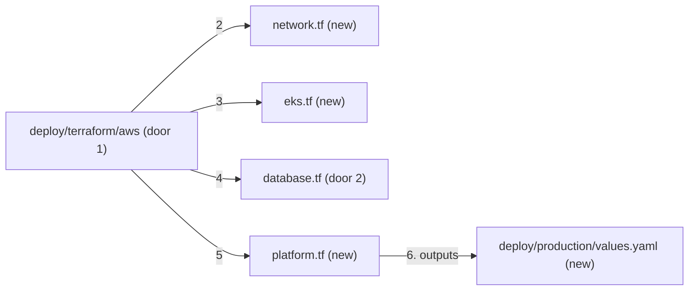

# AWS environment

**Approved**: 2026-10-29 - user: "quero que você prossiga com a execução de todos os passos e testes continuamente, com a minha aprovação, até a implementação completa do desafio"

## Problem

The repository proves the service on a laptop, but says nothing about where it runs 24/7: which
network, which cluster, which database, how a zone failure is absorbed there, or what it costs.
Every production decision so far (RDS Multi-AZ in ADR-001, arm64 images in ADR-002, the Gateway
in ADR-003) has no code behind it.

Evidence: `docs/challenge.md` optional goal "Use it [Terraform] to configure a remote environment
on any cloud provider as well", and its instruction that no cost-incurring service is needed;
AD-004 records that the remote environment is code only.

When this ships, `deploy/terraform/aws` describes a production environment in 3 availability
zones - VPC, EKS on Graviton, RDS for MySQL Multi-AZ DB cluster, the gateway behind a Network Load
Balancer and secrets from AWS Secrets Manager - that validates, passes a security scan and can be
applied by anyone with an AWS account.

## Shape

This mirrors `deploy/terraform/local` (same platform components, same chart), swapping kind for
EKS, the InnoDB Cluster for RDS and the local registry for Docker Hub. The rules - topology,
encryption, network reachability - live in the Terraform configuration, proven by
`terraform validate`, a Trivy misconfiguration scan and Vitest tests over the configuration
rendered by `terraform show -json` of a plan made with mocked providers (`terraform test`).

1. in: `terraform apply` in `deploy/terraform/aws` (door 1) with an S3 backend
2. `network.tf` (new) - VPC module: public, private and database subnets in 3 AZs, one NAT gateway per AZ
3. `eks.tf` (new) - EKS module: managed node group of Graviton instances in the 3 private subnets, 3 to 9 nodes, KMS-encrypted secrets
4. `database.tf` (new) - RDS for MySQL 8.4 Multi-AZ DB cluster (door 2) in the database subnets, reachable only from the nodes, TLS required, master password managed in Secrets Manager
5. `platform.tf` (new) - AWS Load Balancer Controller, Envoy Gateway behind an internet-facing NLB with TLS from ACM, metrics-server, External Secrets syncing the application's database secret
6. out: outputs for the chart's production values (`deploy/production/values.yaml`, new)

**Changes underneath**

| Front | What changes |
| --- | --- |
| domain | nothing |
| stored data | nothing to migrate - a new, empty RDS cluster; the chart's migrations Job creates the schema |
| readers | the chart, through `deploy/production/values.yaml`: `database.ssl: true`, the RDS writer endpoint, `database.existingSecret` synced by External Secrets |

Data: none - this feature only describes infrastructure; it stores nothing until applied.

## Surface

None - no HTTP route changes; the public endpoint is the Gateway of `helm-chart`, behind the NLB.

## Landing

| One-way door | Literal shape | Alternative rejected |
| --- | --- | --- |
| 1. State and layout | one root module per environment under `deploy/terraform/<env>`; remote state in S3 with native locking (`use_lockfile = true`), configured with `-backend-config` | local state: no locking and lost with the laptop; DynamoDB locks: superseded by S3 native locking in Terraform 1.10 |
| 2. Production database | `aws_rds_cluster` engine `mysql` 8.4, `db_cluster_instance_class` `db.m6gd.large`, `storage_type` `io2`, 1 writer and 2 readable standbys in 3 AZs, `storage_encrypted`, `deletion_protection`, 14-day backups, `manage_master_user_password`, `require_secure_transport = ON` | Multi-AZ DB instance: one standby that serves no reads and fails over in about a minute instead of under 35 s; Aurora MySQL: different engine and pricing than local, and ADR-001 chose RDS for MySQL |

- Nothing else in this change is hard to reverse

## Criteria

### S1: Valid and secure by construction (P1)

**Acceptance Criteria**

1. WHEN `terraform init -backend=false` and `terraform validate` run in `deploy/terraform/aws` THEN both SHALL succeed, and `terraform fmt -check -recursive` SHALL report nothing
2. WHEN Trivy scans `deploy/terraform/aws` for misconfigurations THEN it SHALL report no HIGH or CRITICAL finding outside `.trivyignore`, where every entry carries its reason
3. WHEN `terraform test` plans the configuration with mocked AWS providers THEN the plan SHALL succeed

### S2: Highly available across 3 zones (P1)

**Acceptance Criteria**

4. The plan SHALL create a VPC with public, private and database subnets in exactly 3 availability zones and one NAT gateway per zone
5. The plan SHALL create an EKS managed node group of arm64 Graviton instances spanning the 3 private subnets with at least 3 nodes, and EKS secrets encrypted with KMS
6. The plan SHALL create the RDS cluster of door 2, its security group admitting 3306 only from the EKS node security group
7. The plan SHALL install the AWS Load Balancer Controller, Envoy Gateway exposed by an internet-facing NLB terminating TLS with the ACM certificate of `var.certificate_arn`, metrics-server and External Secrets, each pinned to a chart version

### S3: The chart's production values (P2)

**Acceptance Criteria**

8. The repository SHALL hold production values for the chart that set `database.ssl: true`, `database.existingSecret: posts-db`, `rateLimit.enabled: true` and pins the image by digest, and the chart SHALL render it (with the RDS host given) through `helm template` and kubeconform

## Out of scope

| Excluded | Why |
| --- | --- |
| Running `terraform apply` or `plan` against AWS | the test forbids cost-incurring services (AD-004); mocked providers stand in for the account |
| Observability stack (Prometheus, Grafana, alerting) | a platform concern; the pods expose `/metrics` and the NetworkPolicy admits a scraper |
| Multi-region | the requirement is 3 zones; a second region doubles cost without being asked |
| DNS records | the NLB hostname is an output; the DNS zone belongs to the organisation |

## Assumptions

| Assumption | Chosen default | Rationale | Confirmed? |
| --- | --- | --- | --- |
| Region and sizes | `us-east-1`; nodes `m7g.large`; RDS `db.m6gd.large` | broadest service availability; Graviton is cheaper per vCPU (ADR-002); `gd` classes are required by Multi-AZ DB clusters | y - user delegated |
| Versions | EKS 1.35, MySQL `8.4.10` (variable) | inside EKS standard support; same LTS line as local | y - user delegated |
| Application database user | created by a Kubernetes Job from the master secret, as locally | RDS manages only the master user | y - user delegated |

**Open questions:** none - all resolved or logged above.

## Sources

- `docs/challenge.md` - the request - optional goal "Use it to configure a remote environment"
- `.specs/STATE.md` AD-001, AD-004, AD-005, AD-006
