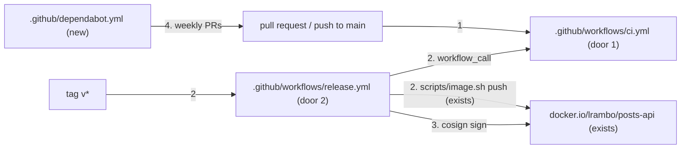

# CI and release

**Approved**: 2026-10-29 - user: "quero que você prossiga com a execução de todos os passos e testes continuamente, com a minha aprovação, até a implementação completa do desafio"

## Problem

Every check in this repository runs only when someone remembers to run it on their own machine,
and releasing an image depends on one maintainer's Docker Hub login. A change that breaks the
tests, the chart or the image can reach `main`, and nobody can tell which commit a published
image came from or whether it was built by the project at all.

Evidence: `docs/challenge.md` evaluation criteria "Release and deployment mechanisms", "Change
history", "Security" and "a project that will be maintained by multiple people"; the repository
has no `.github/` directory.

When this ships, every pull request and push to `main` runs the unit, integration, chart, image,
Terraform and end-to-end checks, and a version tag releases a scanned, signed, multi-arch image
whose signature names the workflow that built it.

## Shape

This reuses the repository's own commands (`yarn`, `scripts/image.sh`, `scripts/local.sh`,
`terraform`) so CI runs exactly what a maintainer runs. The rules that decide an outcome - what
runs when, with which permissions, from which pinned actions - are workflow files, proven by
Vitest tests that parse them and by actionlint.

1. in: a pull request or a push to `main` -> `.github/workflows/ci.yml` (door 1) - jobs `verify`,
   `chart`, `image`, `terraform`, `e2e`, each with read-only repository permissions
2. in: a tag `v*` -> `.github/workflows/release.yml` (door 2) - checks the tag against
   `package.json`, reruns `ci.yml`, then pushes with `scripts/image.sh push` (exists)
3. `.github/workflows/release.yml` (door 2) - signs the pushed digest with cosign keyless, using
   the workflow's OIDC identity
4. `.github/dependabot.yml` (new) - weekly update pull requests for npm, Docker, GitHub Actions
   and Terraform
5. out: a green or red check on the commit; for tags, `docker.io/lrambo/posts-api:<version>` with
   a signature

**Changes underneath**

| Front | What changes |
| --- | --- |
| domain | nothing |
| stored data | nothing to migrate |
| readers | the repository owner must add the secrets `DOCKERHUB_USERNAME` and `DOCKERHUB_TOKEN` (a Docker Hub access token with push rights) before the first release |

Data: none - workflows store nothing beyond the published image and its signature.

## Surface

None - no HTTP route changes. The workflows' triggers and outputs are criteria 1-10.

## Landing

| One-way door | Literal shape | Alternative rejected |
| --- | --- | --- |
| 1. CI contract | `ci.yml` on `pull_request` and `push` to `main`, plus `workflow_call`; top-level `permissions: contents: read`; `concurrency` per ref cancelling superseded runs; every action pinned to a 40-character commit SHA with its version in a comment | actions by tag (`@v4`): a moved tag runs code nobody reviewed with the workflow's permissions |
| 2. Release contract | tags `v<package.json version>` release; the job holds `id-token: write` only to sign; signatures are keyless (Sigstore), verified with `cosign verify --certificate-identity-regexp '^https://github.com/lucrambo/infrastructure-interview-test/.github/workflows/release.yml@refs/tags/v' --certificate-oidc-issuer https://token.actions.githubusercontent.com` | a long-lived cosign key in a secret: it can leak and must be rotated; releasing on every push to `main`: versions would no longer be deliberate |

- Nothing else in this change is hard to reverse

## Criteria

### S1: Every change is checked (P1)

**Acceptance Criteria**

1. WHEN a pull request is opened or updated, or a commit is pushed to `main`, THEN the `ci` workflow SHALL run the jobs `verify` (`yarn lint`, `yarn typecheck`, `yarn build`, `yarn test`, the production audit), `chart` (`helm lint --strict`, `yarn test:chart`), `image` (`scripts/image.sh build`, `scripts/image.sh scan`, `yarn test:image`), `terraform` (`fmt -check` and `validate` for every configuration) and `e2e` (`scripts/local.sh all`)
2. The workflows SHALL set `permissions: contents: read` at the top level and grant any other permission only to the job that needs it
3. The workflows SHALL name a full 40-character commit SHA in every `uses:` of an action outside this repository
4. the `ci` workflow SHALL cancel an in-progress run of the same workflow and ref when a newer one starts
5. The workflows SHALL pass actionlint with no problem reported

### S2: Releases are deliberate, scanned and signed (P1)

**Acceptance Criteria**

6. WHEN a tag `v*` is pushed THEN the `release` workflow SHALL run the `ci` workflow first and publish only if it passes
7. IF the tag is not `v` followed by the `package.json` version THEN the `release` workflow SHALL fail before publishing
   - tag `v0.1.0` with version `0.1.0` → continues; tag `v0.2.0` with version `0.1.0` → fails; tag `0.1.0` → does not trigger
8. WHEN the `release` workflow publishes THEN it SHALL log in with the secrets `DOCKERHUB_USERNAME` and `DOCKERHUB_TOKEN`, run `scripts/image.sh scan` and `scripts/image.sh push`, and sign the pushed digest with cosign keyless
9. WHEN a release has run THEN `cosign verify` with the identity of door 2 SHALL succeed for `docker.io/lrambo/posts-api:<version>`

### S3: Dependencies stay current (P2)

**Acceptance Criteria**

10. The repository SHALL configure Dependabot to open weekly update pull requests for npm, the Dockerfile, GitHub Actions and both Terraform configurations

## Out of scope

| Excluded | Why |
| --- | --- |
| Deploying to a remote cluster from CI | no remote environment is provisioned (AD-004: remote Terraform is code only); the release publishes the image the chart deploys |
| Re-signing the already published `0.1.0` | it was pushed before signing existed; the next version is the first signed release |
| Branch protection rules | a repository setting, not code; the README tells the owner which checks to require |

## Assumptions

| Assumption | Chosen default | Rationale | Confirmed? |
| --- | --- | --- | --- |
| Runner | `ubuntu-24.04` GitHub-hosted | free for public repositories, has Docker; 4 vCPU and 16 GB fit the kind environment | y - user delegated |
| e2e in CI | on every pull request and push to `main` | the availability guarantees are the point of the exercise; about 20 minutes | y - user delegated |
| Proof of criteria 1, 6, 8 and 9 on GitHub | after the final push, with the user's go-ahead | pushing and creating secrets need explicit authorization (CLAUDE.md); locally the workflows are proven by parsing and actionlint | y - user: "Caso seja necessária uma autorização, concederei quando já estiver todo encaminhado" |

**Open questions:**

- blocks go-live: the secrets `DOCKERHUB_USERNAME` and `DOCKERHUB_TOKEN` must exist in the GitHub repository before the first tag release (criteria 8-9)

## Sources

- `docs/challenge.md` - the request - evaluation criteria named in `Problem`
- `.specs/STATE.md` AD-002, AD-005 - Docker Hub and the tag policy
