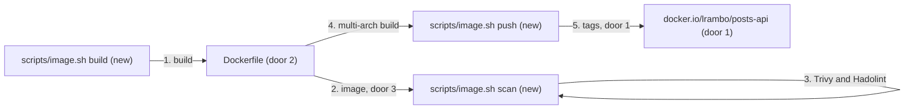

# Container image

**Approved**: 2026-10-29 - user: "aprovado. prossiga"

## Problem

The service can only be run from a source checkout with Node.js and Yarn installed, so nothing
can deploy it to a cluster, and the test's first requirement - a container image published in a
public registry - is unmet. Anyone who wants to run it has to rebuild it, and two people who do
get different artifacts.

Evidence: `docs/challenge.md` requirement 1, "Create a container image with the application in
this repository and publish it in a public repository"; the repository has no `Dockerfile`.

When this ships, anyone can pull `docker.io/lrambo/posts-api` at an immutable version for amd64 or
arm64, and the image runs the server or the migrations as a non-root user with no shell, on a
read-only filesystem, with no known high or critical vulnerability.

## Shape

This reuses the app's own build (`yarn build`) and its production dependency set; the image adds
no runtime behaviour. The rules that decide an outcome - which tag is pushed, refusing to
overwrite a version - run in `scripts/image.sh`, and the image's properties are proven by Vitest
tests in `tests/image/` that run the built image with Testcontainers against MySQL 8.4.

1. in: `scripts/image.sh build` (new) -> `Dockerfile` (door 2) build stage on `node:24-trixie-slim`:
   `yarn install --immutable`, `yarn build`, `yarn workspaces focus --production`
2. `Dockerfile` (door 2) runtime stage on distroless `nodejs24-debian13:nonroot`: copies
   `package.json`, production `node_modules` and `dist/`, adds OCI labels, hands on the image
   whose contract is door 3
3. `scripts/image.sh scan` (new) - Trivy and Hadolint, each in a container, fail on findings
4. `scripts/image.sh push` (new) - refuses a dirty tree or an existing version tag, then builds
   amd64 and arm64 with SBOM and provenance and pushes the tags of door 1
5. out: `docker.io/lrambo/posts-api:<version>` and `:sha-<commit>`, one multi-arch index

**Changes underneath**

| Front | What changes |
| --- | --- |
| domain | nothing - the app's behaviour is unchanged; `yarn start` and the image run the same `dist/server.js` |
| stored data | nothing to migrate - the image runs the existing migrations command |
| readers | the Helm chart (feature `helm-chart`) consumes door 1 and door 3; `README.md` gains a Container image section |

Data: none - the image stores nothing; the database is unchanged.

## Surface

None - no HTTP route changes. The three `scripts/image.sh` commands are maintainer tooling; their
inputs, outputs and exit codes are criteria 10-14.

## Landing

| One-way door | Literal shape | Alternative rejected |
| --- | --- | --- |
| 1. Image name and tags | `docker.io/lrambo/posts-api:<package.json version>` and `:sha-<7-char commit>`; a version tag is never overwritten; no `latest` | `latest` or re-pushed version tags: the same reference names different builds over time, so a rollout or rollback is not reproducible |
| 2. Base images, pinned by digest | build `node:24-trixie-slim@sha256:54f84b4c...`, runtime `gcr.io/distroless/nodejs24-debian13:nonroot@sha256:a6c34457...` - [ADR-002](../../../docs/adr/002-use-distroless-runtime-image.md) | `node:24-alpine`: musl instead of glibc, plus shell and package manager in production; `node:24-slim` as runtime: shell, apt and about 3x the size |
| 3. Container contract, consumed by the Helm chart | entrypoint `/nodejs/bin/node`, `CMD ["dist/server.js"]`, migrations with args `node_modules/typeorm/cli.js migration:run -d dist/data-source.js`, `WORKDIR /app`, port `3000`, uid/gid `65532`, writes nothing to the filesystem | a shell entrypoint script: needs a shell in the image and hides signals from Node.js |
| 4. Platforms | `linux/amd64` and `linux/arm64` in one OCI index, with SBOM and provenance attestations | amd64 only: rules out arm64 nodes (AWS Graviton), which cost less per vCPU |

- Nothing else in this change is hard to reverse

## Criteria

### S1: A minimal, non-root image (P1)

The image runs the service and its migrations with nothing an attacker could use.

**Acceptance Criteria**

1. WHEN the image runs with the database variables of a migrated MySQL 8.4 THEN `GET /readyz` SHALL answer 200 on port 3000
2. WHEN the image runs with args `node_modules/typeorm/cli.js migration:run -d dist/data-source.js` against an empty database THEN it SHALL create the schema and exit 0
3. The image SHALL run as uid 65532 and gid 65532
4. The image SHALL contain no shell: running `/bin/sh` or `/bin/bash` in it fails to start
5. WHEN the image runs with a read-only root filesystem THEN `GET /readyz` SHALL still answer 200
6. The image SHALL contain `dist/` and production dependencies only: no `src/`, `tests/`, `.git`, `.env`, `typescript`, `vitest` or `eslint`
7. WHEN `docker stop` sends SIGTERM to a serving container THEN the container SHALL exit with code 0 within 10 seconds
8. The image SHALL carry the OCI labels `org.opencontainers.image.source` = `https://github.com/lucrambo/infrastructure-interview-test`, `revision` = the commit, `version` = the `package.json` version, `licenses` = `MIT` and `title` = `posts-api`
9. The image SHALL be at most 100 MB as `docker image inspect` reports it for linux/amd64

### S2: Scanned and published (P1)

Only a clean, versioned image reaches the public registry, and a version never changes.

**Acceptance Criteria**

10. WHEN `scripts/image.sh scan` runs THEN Trivy SHALL report no HIGH or CRITICAL vulnerability with a fix available, Hadolint SHALL report no warning on `Dockerfile`, and the script SHALL exit 0
11. IF the scan finds a HIGH or CRITICAL vulnerability with a fix available or a Hadolint warning THEN `scripts/image.sh scan` SHALL exit 1
12. WHEN `scripts/image.sh push` runs on a clean tree THEN `docker.io/lrambo/posts-api` SHALL hold tags `<version>` and `sha-<commit>` resolving to the same index with `linux/amd64` and `linux/arm64` manifests, an SBOM and a provenance attestation
13. IF the tree has uncommitted changes THEN `scripts/image.sh push` SHALL exit 1 before building
14. IF tag `<version>` already exists in the registry THEN `scripts/image.sh push` SHALL exit 1 without pushing anything
15. WHEN the image is published THEN an anonymous `docker pull docker.io/lrambo/posts-api:<version>` SHALL succeed
16. The `Dockerfile` SHALL reference every base image by digest

## Out of scope

| Excluded | Why |
| --- | --- |
| Image signing (cosign) | keyless signing needs the CI's OIDC identity; it lands with feature `ci-release` |
| Building and pushing from CI | feature `ci-release`; this feature gives it the script to call |
| Private registry credentials in Kubernetes | feature `helm-chart` (`imagePullSecrets`) |
| An `app` service in `compose.yaml` | local development runs the app from source; the image is proven by its own tests |

## Assumptions

| Assumption | Chosen default | Rationale | Confirmed? |
| --- | --- | --- | --- |
| Repository name | `docker.io/lrambo/posts-api` | the service's `package.json` name under the user's account | y - user delegated: "pode fazer todas as configurações necessárias e definir o nome do repo" |
| First published version | `0.1.0`, the current `package.json` version | the API changed its contract in `app-hardening`, so this is the first release, pre-1.0 | y - user delegated |
| Scanners | Trivy and Hadolint run from their official images | no local install; the same commands run in CI | y - user delegated |
| Size bound | 100 MB | measured prototype is 63 MB: 55 MB distroless base and 58 MB uncompressed dependencies | y - user delegated |
| Publishing | each `scripts/image.sh push` to Docker Hub is confirmed with the user first | CLAUDE.md: publishing images needs an explicit go-ahead each time | y - CLAUDE.md |

**Open questions:** none - all resolved or logged above.

## Sources

- `docs/challenge.md` - the request - requirement 1 and "Release and deployment mechanisms", "Security", "Cost"
- `.specs/STATE.md` AD-002 - Docker Hub as the public registry
