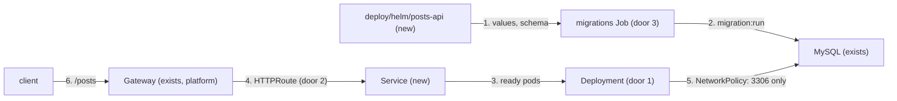

# Helm chart

**Approved**: 2026-10-29 - user: "quero que você prossiga com a execução de todos os passos e testes continuamente, com a minha aprovação, até a implementação completa do desafio"

## Problem

The published image cannot be deployed to Kubernetes: nothing describes how many replicas run,
where they are placed, how they are probed, how they are exposed, which secrets they read or when
the migrations run. Without that, a node or zone failure, a rollout or a bad request rate takes
the service down, and every environment would be hand-written.

Evidence: `docs/challenge.md` requirements 2, 3 and 4 ("deploy the image in a kubernetes cluster",
"Expose the application externally", "highly available setup, considering the cluster has worker
nodes in 3 different availability zones") and the optional goals "Use Helm", "Add a reverse proxy",
"Configure Kubernetes to authenticate to a private container repository".

When this ships, one `helm install` deploys the service with replicas spread over 3 zones, survives
the loss of a zone, a node drain or a rollout without dropping requests, scales with load, runs
its migrations once per release, and is reachable from outside the cluster only on `/posts`
through a Gateway API reverse proxy.

## Shape

This packages the image of `container-image` and its contract (door 3 there) unchanged; the chart
adds only Kubernetes objects. The rules that decide an outcome - which objects render for a set of
values, and what each one says - run in the templates, proven by Vitest tests that render the
chart with `helm template`, parse the YAML and validate it with kubeconform.

1. in: `helm upgrade --install` with values -> `deploy/helm/posts-api` (new) - `values.schema.json`
   rejects invalid values before anything renders
2. pre-install and pre-upgrade hook: migrations `Job` (door 3) runs the image with the migrations
   arguments against the database of the values, and the release waits for it
3. `Deployment` (door 1) - replicas spread across zones and nodes, probes, graceful termination,
   restricted security context; `HorizontalPodAutoscaler` and `PodDisruptionBudget` around it
4. `Service` (ClusterIP) -> `HTTPRoute` (door 2) attached to a `Gateway` the platform owns;
   optional Envoy Gateway `BackendTrafficPolicy` rate limit
5. `NetworkPolicy` (new) - only the gateway and the metrics scraper reach the pods; pods reach only DNS
   and the database
6. out: `https://<host>/posts` served by any ready replica

**Changes underneath**

| Front | What changes |
| --- | --- |
| domain | nothing - the API is unchanged |
| stored data | nothing to migrate - the Job runs the existing migrations |
| readers | the `local-env` and `ci-release` features install this chart; production values point it at RDS (AD-001) |

Data: none - the chart stores nothing; the database is provided by the platform (feature `database`
locally, RDS in production).

## Surface

| Route | In | Out | Status | Who |
| --- | --- | --- | --- | --- |
| `GET /posts`, `GET /posts/:id`, `POST /posts` through the Gateway | as in `app-hardening` | as in `app-hardening` | `200`, `201`, `400`, `404`, `413`, `415`, `429` when the optional rate limit trips | anyone - authentication is still out of scope |
| `/healthz`, `/readyz`, `/metrics` through the Gateway | - | not routed | `404` from the Gateway | nobody outside the cluster; kubelet probes and the scraper reach the pod directly |

## Landing

| One-way door | Literal shape | Alternative rejected |
| --- | --- | --- |
| 1. Placement and availability | `topologySpreadConstraints`: `topology.kubernetes.io/zone` `maxSkew: 1` `DoNotSchedule`, `kubernetes.io/hostname` `maxSkew: 1` `ScheduleAnyway`; at least 3 replicas (HPA `minReplicas: 3`, `maxReplicas: 10`, CPU 70%); `PodDisruptionBudget` `maxUnavailable: 1`; `RollingUpdate` `maxUnavailable: 0`, `maxSurge: 25%` | pod anti-affinity per zone: caps replicas at one per zone and cannot scale past 3; `ScheduleAnyway` on zones: a scheduler under pressure could stack every replica in one zone |
| 2. External exposure through the Gateway API | `gateway.networking.k8s.io/v1` `HTTPRoute`, `parentRefs` from values, one rule `PathPrefix /posts` to the Service port `http`; Envoy Gateway as the local implementation - [ADR-003](../../../docs/adr/003-expose-through-the-gateway-api.md) | ingress-nginx `Ingress`: the project was retired in March 2026 and gets no security fixes; `Service type: LoadBalancer`: exposes probes and metrics and gives no routing or rate limiting |
| 3. Migrations as a Helm hook | `Job` with `helm.sh/hook: pre-install,pre-upgrade`, `hook-weight: "0"`, `hook-delete-policy: before-hook-creation,hook-succeeded`, `backoffLimit: 2`, `activeDeadlineSeconds: 300`; args `node_modules/typeorm/cli.js migration:run -d dist/data-source.js` | an init container: every replica would run the migrations on every start; a manual step: releases would depend on someone remembering it |
| 4. Configuration contract | non-secret settings in a `ConfigMap`, `DB_PASSWORD` from a `Secret` key - created from `database.password` or an existing one named by `database.existingSecret` (for External Secrets in production); a `checksum/config` pod annotation rolls the pods when either changes | the password in the `ConfigMap` or the values file committed with it: readable by anyone who can read the namespace or the repository |

- Nothing else in this change is hard to reverse

## Criteria

### S1: Highly available across 3 zones (P1)

The service keeps answering when a zone, a node or a replica goes away, and while it is rolled.

**Acceptance Criteria**

1. The chart SHALL render a `Deployment` with the zone and hostname `topologySpreadConstraints` of door 1, selecting the release's pods
2. WHERE `autoscaling.enabled` is true (the default) the chart SHALL render an `autoscaling/v2` `HorizontalPodAutoscaler` with `minReplicas: 3`, `maxReplicas: 10` and a CPU utilization target of 70%, and the `Deployment` SHALL set no `replicas`
3. WHERE `autoscaling.enabled` is false the `Deployment` SHALL set `replicas` from `replicaCount`, default 3
4. The chart SHALL render a `PodDisruptionBudget` with `maxUnavailable: 1` for the release's pods
5. The `Deployment` SHALL roll with `maxUnavailable: 0` and `maxSurge: 25%`
6. The container SHALL have a startup probe on `/healthz` (period 2 s, failure threshold 30), a readiness probe on `/readyz` (period 5 s, failure threshold 2) and a liveness probe on `/healthz` (period 10 s, failure threshold 3), all on port `http`
7. The pod SHALL have a `preStop` `sleep` of 5 seconds, `terminationGracePeriodSeconds: 35` and `SHUTDOWN_TIMEOUT_MS=25000`, so endpoints are removed before the server drains and the drain ends before the kill
8. The container SHALL request `100m` CPU and `128Mi` memory and be limited to `256Mi` memory, with no CPU limit

### S2: Least privilege (P1)

A compromised pod can do as little as possible.

**Acceptance Criteria**

9. The pod SHALL run with `runAsNonRoot: true`, `runAsUser` and `runAsGroup` `65532`, `seccompProfile: RuntimeDefault`, and the container with `readOnlyRootFilesystem: true`, `allowPrivilegeEscalation: false` and every capability dropped
10. The chart SHALL render its own `ServiceAccount` with `automountServiceAccountToken: false`, used by the `Deployment` and the migrations `Job`
11. The chart SHALL render a `NetworkPolicy` that admits ingress to port 3000 only from the namespaces in `networkPolicy.gatewayNamespace` and `networkPolicy.monitoringNamespace`, and egress only to DNS (UDP and TCP 53) and the database port
12. The container SHALL read `DB_PASSWORD` from a `Secret` key and the chart SHALL NOT render the password in any `ConfigMap`, environment value or annotation
    - `database.password` set → a chart `Secret`; `database.existingSecret: db-creds` → no chart `Secret`, the key read from `db-creds`
13. WHERE `imagePullSecrets` is set the `Deployment` and the `Job` SHALL reference those secrets, and WHERE `imageCredentials` is set the chart SHALL render a `kubernetes.io/dockerconfigjson` `Secret` for that registry and reference it
14. The image SHALL be `image.repository:image.tag`, the tag defaulting to the chart's `appVersion` `0.1.0`, or `image.repository@image.digest` when a digest is set

### S3: Exposed through a reverse proxy (P1)

Clients reach the API through the Gateway, and nothing else.

**Acceptance Criteria**

15. The chart SHALL render a `ClusterIP` `Service` with port `80` named `http` targeting the container port `http` (3000)
16. WHERE `httpRoute.enabled` is true (the default) the chart SHALL render an `HTTPRoute` with the `parentRefs` and `hostnames` of the values and one rule matching `PathPrefix` `/posts` to the Service port 80, and no rule for `/healthz`, `/readyz` or `/metrics`
17. WHERE `rateLimit.enabled` is true the chart SHALL render an Envoy Gateway `BackendTrafficPolicy` targeting the `HTTPRoute` with a local limit of `rateLimit.requests` per `rateLimit.unit`, default 100 per second

### S4: Migrations once per release (P1)

18. The chart SHALL render the migrations `Job` of door 3 with the Deployment's image, service account, security context, configuration and secret

### S5: Correct by construction (P2)

19. WHEN the chart is rendered with its defaults and with every optional feature enabled THEN `helm lint --strict` SHALL pass and kubeconform SHALL validate every object against Kubernetes 1.34 and the Gateway API and Envoy Gateway schemas
20. IF the values violate `values.schema.json` THEN `helm template` SHALL fail naming the field
    - `replicaCount: 0` → fails; `autoscaling.minReplicas: 1` → fails (below 3 breaks zone redundancy); `image.repository` empty → fails; `database.host` missing → fails
21. WHEN the `ConfigMap` or the `Secret` content changes THEN the pod template's `checksum/config` annotation SHALL change

## Out of scope

| Excluded | Why |
| --- | --- |
| Installing the Gateway, Envoy Gateway, metrics-server or MySQL | platform components, installed by `local-env` and `database` locally and by the platform team in production |
| A `ServiceMonitor` | needs the Prometheus Operator CRDs, which no environment here has; the pods expose `/metrics` and the NetworkPolicy admits the scraper |
| TLS certificates on the Gateway | owned by the Gateway (cert-manager in production); the local Gateway listens on HTTP |
| Running the chart in a cluster | proven end to end by `local-env` |

## Assumptions

| Assumption | Chosen default | Rationale | Confirmed? |
| --- | --- | --- | --- |
| Chart location | `deploy/helm/posts-api`, chart version `0.1.0`, `appVersion` `0.1.0` | one chart per deployable, beside future `deploy/` code | y - user delegated |
| Gateway API implementation | Envoy Gateway, chosen in ADR-003 | CNCF, implements the Gateway API core and offers rate limiting | y - user delegated |
| Kubernetes version for validation | 1.34 | the oldest minor still supported upstream, so the chart works on current EKS and kind | y - user delegated |
| Resources and probe timings | as in criteria 6-8 | measured image starts in under 1 s; a memory limit protects the node, a CPU limit would only throttle | y - user delegated |

**Open questions:** none - all resolved or logged above.

## Sources

- `docs/challenge.md` - the request - requirements 2-4 and the optional goals named in `Problem`
- `.specs/features/container-image/plan.md` door 3 - the container contract
- `.specs/features/app-hardening/plan.md` S4 - probes, shutdown and metrics endpoints
