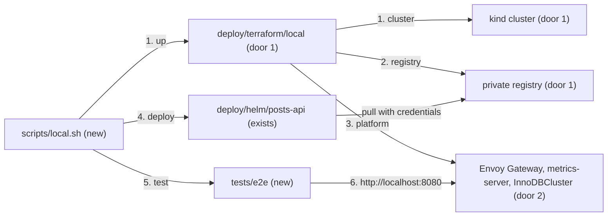

# Local environment

**Approved**: 2026-10-29 - user: "quero que você prossiga com a execução de todos os passos e testes continuamente, com a minha aprovação, até a implementação completa do desafio"

## Problem

Nothing shows that the chart actually delivers what it promises. No cluster exists in which a
reviewer can see replicas in 3 zones, a rollout without errors, a zone or database primary
failing, a private registry pull or the gateway hiding the probes. Building such a cluster by
hand takes hours, and no two people would get the same one.

Evidence: `docs/challenge.md` "Testing" ("use any free local kubernetes distribution") and the
optional goals "Create a script to configure a local kubernetes cluster, deploy the application
and run the test scenarios", "Configure the local kubernetes cluster to have 2+ worker nodes",
"Use Terraform to configure the local environment", "Write a few test scenarios" and "Configure
Kubernetes to authenticate to a private container repository".

When this ships, `scripts/local.sh all` builds a kind cluster with workers in 3 zones, a highly
available MySQL, a gateway and a private registry with Terraform. It deploys the locally built
image from that registry and proves, with functional, load and failure scenarios, that the
service stays correct and available.

## Shape

This reuses the chart of `helm-chart` and the image of `container-image` unchanged: Terraform owns
the environment, Helm owns the application release. The rules that decide an outcome live in the
Terraform configuration and in `scripts/local.sh`; the end-to-end scenarios that prove them are
Vitest tests in `tests/e2e/` driving k6, kubectl and docker against the running cluster.

1. in: `scripts/local.sh up` (new) -> `deploy/terraform/local` (door 1) - kind cluster
   `posts-api`: 1 control-plane and 3 workers labelled `zone-a`, `zone-b`, `zone-c`
2. `deploy/terraform/local` (door 1) - private `registry:3` with htpasswd auth on the kind network,
   nodes configured to pull from it over HTTP
3. `deploy/terraform/local` (door 1) - Envoy Gateway with the `Gateway` `public` on host port
   8080, metrics-server, MySQL Operator and an `InnoDBCluster` of 3 members (door 2), one per zone,
   behind 2 MySQL Router replicas; a Job creates the `posts` database and user
4. `scripts/local.sh deploy` (new) - builds the image, pushes it to the private registry and runs
   `helm upgrade --install` of `deploy/helm/posts-api` (exists) with `deploy/local/values.yaml`
   (new): registry credentials, the database's existing secret, rate limit on
5. `scripts/local.sh test` (new) - runs `tests/e2e/` (new): k6 functional and load scenarios
   through the gateway, then the availability scenarios
6. out: `http://localhost:8080/posts`, and a test report with exit code 0 or 1

**Changes underneath**

| Front | What changes |
| --- | --- |
| domain | nothing - the API is unchanged |
| stored data | nothing to migrate - the chart's migrations Job creates the schema in the new database |
| readers | `ci-release` runs the same script in CI; the README gains a Local Kubernetes section |

Data: none - the local database is disposable and recreated by `scripts/local.sh up`.

## Surface

| Route | In | Out | Status | Who |
| --- | --- | --- | --- | --- |
| `http://localhost:8080/posts...` | as in `app-hardening` | as in `app-hardening` | `200`, `201`, `400`, `404`, `413`, `415`, `429` past the local rate limit | anyone on the developer machine |
| `http://localhost:8080/healthz`, `/readyz`, `/metrics` | - | not routed | `404` | nobody |

The script's commands are criteria 5-6.

## Landing

| One-way door | Literal shape | Alternative rejected |
| --- | --- | --- |
| 1. Environment as Terraform, application as Helm | `deploy/terraform/local` (providers `tehcyx/kind` 0.13, `hashicorp/helm` 3.3, `hashicorp/kubernetes` 3.4, `kreuzwerker/docker` 3.x) creates the cluster, registry and platform; the app is released by `helm upgrade --install` from `scripts/local.sh`, as CI and production will | the app as a Terraform `helm_release`: every release would become an infrastructure apply, and Terraform state would hold the app's secrets |
| 2. Database topology | MySQL Operator 2.3.1, `InnoDBCluster` `mysql` in namespace `database`, MySQL 8.4.10, `serverInstances: 3` with `topologySpreadConstraints` on `topology.kubernetes.io/zone` (`DoNotSchedule`), `router.instances: 2` spread the same way; the app connects to the Router service `mysql.database.svc:3306` | a single MySQL Pod: a zone outage would stop every write and lose data on that node (ADR-001) |

- Nothing else in this change is hard to reverse

## Criteria

### S1: A reproducible cluster from Terraform (P1)

**Acceptance Criteria**

1. WHEN `terraform apply` runs in `deploy/terraform/local` THEN it SHALL create the kind cluster `posts-api` with 1 control-plane and 3 worker nodes whose `topology.kubernetes.io/zone` labels are `zone-a`, `zone-b` and `zone-c`
2. WHEN the apply completes THEN the `Gateway` `public` in namespace `gateway` SHALL be `Programmed` and answer on `http://localhost:8080`, and metrics-server SHALL serve node metrics
3. WHEN the apply completes THEN the `InnoDBCluster` `mysql` SHALL be `ONLINE` with 3 members on 3 different zones and 2 Router pods on 2 different zones, and the database `posts` and user `posts` SHALL exist
4. WHEN `terraform plan` runs right after an apply THEN it SHALL report no changes
5. The configuration SHALL pass `terraform fmt -check -recursive` and `terraform validate`

### S2: A script from nothing to tested (P1)

**Acceptance Criteria**

6. WHEN `scripts/local.sh all` runs on a machine with Docker, kind, Terraform, Helm, kubectl, k6 and Node.js THEN it SHALL run `up`, `deploy` and `test` in order and exit 0 only if every scenario passes; each command also runs alone, `down` destroys everything, and an unknown command exits 2 with the usage
7. WHEN `scripts/local.sh deploy` runs THEN the cluster SHALL run the image built from the working tree's commit, pulled from the private registry with the chart's `imageCredentials`, and `helm upgrade --install` SHALL wait for the rollout
8. IF a pod pulls the same image from the private registry without credentials THEN the pull SHALL fail as unauthorized

### S3: Correct through the gateway (P1)

**Acceptance Criteria**

9. WHEN the k6 functional scenario runs against `http://localhost:8080` THEN every check SHALL pass: create returns 201 with `Location`, the created post reads back unchanged, the list paginates with a `Link` header, invalid input returns 400 problem+json, an absent post returns 404, and `/healthz`, `/readyz` and `/metrics` return 404 from the gateway
10. WHEN the k6 load scenario sends 30 requests per second for 60 seconds (80% reads, 20% writes) THEN fewer than 1% of requests SHALL fail and the 95th percentile duration SHALL be under 500 ms
11. WHEN 200 requests arrive within one second THEN the gateway SHALL answer some of them with 429, with the local rate limit at 50 requests per second

### S4: Available through failures (P1)

**Acceptance Criteria**

12. WHEN the deployment is ready THEN its 3 pods SHALL run on 3 nodes of 3 different zones
13. WHILE k6 sends steady traffic, WHEN `helm upgrade` rolls every pod THEN no request SHALL fail
14. WHEN the worker node of the zone that hosts the MySQL primary is stopped THEN within 180 seconds `GET /posts` and `POST /posts` through the gateway SHALL succeed for 30 consecutive seconds, and every post created before the stop SHALL still be readable
15. IF a pod outside the gateway namespace connects to an API pod on port 3000 THEN the connection SHALL time out, while the same request through the gateway succeeds
16. WHEN the load scenario runs THEN the `HorizontalPodAutoscaler` SHALL report a current CPU utilization, not `<unknown>`

## Out of scope

| Excluded | Why |
| --- | --- |
| TLS on the local gateway | no certificate authority locally; production terminates TLS at its own Gateway |
| Backups and point-in-time recovery of the local database | the local database is disposable; production uses RDS backups (ADR-001) |
| A highly available control-plane | kind's control-plane is a single container; production uses a managed control-plane (EKS) |
| Separate migration and application database users | one `posts` user with rights on `posts.*` locally; noted for production |

## Assumptions

| Assumption | Chosen default | Rationale | Confirmed? |
| --- | --- | --- | --- |
| Kubernetes version | kind node `v1.36.4` (amended from `v1.35.8` during the build) | within one minor of kubectl 1.37, the supported skew; kind 0.33 ships it | y - user delegated |
| Host ports | gateway `8080`, registry `5001`, both on 127.0.0.1 | free on this machine; never exposed to the network | y - user delegated |
| Thresholds | as in criteria 10, 11, 14 | sized for a laptop running 4 nodes and 3 MySQL members in 8 GB | y - user delegated |
| Secrets | generated by Terraform (`random_password`), kept in local state and Kubernetes Secrets | local and disposable; production reads them from AWS Secrets Manager | y - user delegated |

**Open questions:** none - all resolved or logged above.

## Sources

- `docs/challenge.md` - the request - "Testing" and the optional goals named in `Problem`
- `.specs/features/helm-chart/plan.md` - the chart and its values
- `.specs/STATE.md` AD-001, AD-003, AD-006 - MySQL topology, kind with 3 zoned workers, Gateway API
