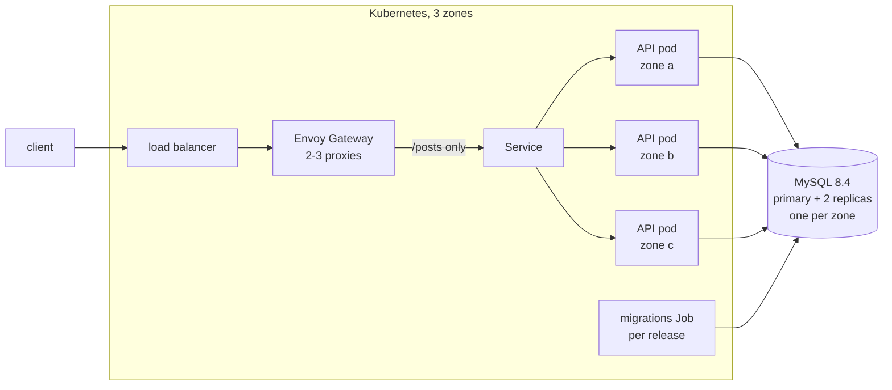

# Posts API

HTTP API for posts and their categories, written in TypeScript (Express 5, TypeORM) on MySQL 8.4.
It is built to run as several stateless replicas behind a load balancer: configuration comes from
the environment, the schema is owned by versioned migrations, and every replica exposes liveness,
readiness and Prometheus metrics.

The original exercise statement is kept in [docs/challenge.md](docs/challenge.md). Design
decisions are logged in [.specs/STATE.md](.specs/STATE.md), with the important ones as ADRs in
[docs/adr/](docs/adr/).

## How the exercise is answered

| Asked                            | Where                                                                                                                                                                                                                                    |
| -------------------------------- | ---------------------------------------------------------------------------------------------------------------------------------------------------------------------------------------------------------------------------------------- |
| 1. Image in a public repository  | [`docker.io/lrambo/posts-api`](https://hub.docker.com/r/lrambo/posts-api), built by [`Dockerfile`](Dockerfile) and [`scripts/image.sh`](scripts/image.sh) ([Container image](#container-image))                                          |
| 2. Deploy to Kubernetes          | Helm chart [`deploy/helm/posts-api`](deploy/helm/posts-api)                                                                                                                                                                              |
| 3. Expose it outside the cluster | Gateway API `HTTPRoute` through Envoy Gateway, only `/posts` ([ADR-003](docs/adr/003-expose-through-the-gateway-api.md))                                                                                                                 |
| 4. Highly available over 3 zones | replicas spread one per zone, PDB, HPA, zero-downtime rollouts and shutdown; MySQL with one member per zone ([ADR-001](docs/adr/001-use-mysql-with-innodb-cluster-and-rds-multi-az.md)); proven by the zone-outage and rollout scenarios |
| Private registry authentication  | the chart's `imageCredentials`; the local cluster pulls from an authenticated registry                                                                                                                                                   |
| Build and deploy script          | [`scripts/image.sh`](scripts/image.sh), [`scripts/local.sh`](scripts/local.sh)                                                                                                                                                           |
| Reverse proxy                    | Envoy Gateway, with edge rate limiting                                                                                                                                                                                                   |
| Test scenarios                   | unit, integration, image, chart and end-to-end suites, k6 functional, load and burst scenarios                                                                                                                                           |
| Local cluster script, 2+ workers | `scripts/local.sh all`: kind with 3 workers in 3 zones                                                                                                                                                                                   |
| Helm                             | [`deploy/helm/posts-api`](deploy/helm/posts-api)                                                                                                                                                                                         |
| Terraform, local and remote      | [`deploy/terraform/local`](deploy/terraform/local) (applied by `scripts/local.sh`), [`deploy/terraform/aws`](deploy/terraform/aws) (code only)                                                                                           |

The application itself was hardened for production first: configuration validated from the
environment, migrations instead of schema sync, input validation, keyset pagination, RFC 9457
errors, health probes, graceful shutdown, JSON logs and metrics
([plan](.specs/features/app-hardening/plan.md)).



Each feature was specified, built and verified with the `tlc-spec-lean` workflow: a plan with
acceptance criteria, checks with proofs, the build, then an independent verifier with mutation
testing. The artefacts are under [.specs/features/](.specs/features/).

## Repository layout

| Path                                        | Contents                                                                                |
| ------------------------------------------- | --------------------------------------------------------------------------------------- |
| `src/`                                      | the API (Express 5, TypeORM, MySQL)                                                     |
| `tests/`                                    | `unit`, `integration`, `image`, `chart`, `ci`, `e2e` suites (Vitest) and `k6` scenarios |
| `Dockerfile`, `scripts/image.sh`            | the container image                                                                     |
| `deploy/helm/posts-api`                     | the Helm chart                                                                          |
| `deploy/terraform/local`, `deploy/local`    | the local environment and its values                                                    |
| `deploy/terraform/aws`, `deploy/production` | the AWS environment and its values                                                      |
| `.github/`                                  | CI, releases and Dependabot                                                             |
| `docs/adr/`, `.specs/`                      | decisions, plans, checks and verification reports                                       |

## Requirements

- Node.js 24 LTS (Yarn 4 is pinned in `package.json` and provided by Corepack)
- Docker, for the local database and the integration tests

## Local development

```bash
corepack enable
yarn install --immutable
cp .env.example .env
docker compose up -d --wait db
yarn build
yarn migration:run
yarn start
```

Then `curl http://localhost:3000/posts` returns `[]`. Stop the database with
`docker compose down` (add `-v` to delete its data).

| Command                                        | What it does                                                                 |
| ---------------------------------------------- | ---------------------------------------------------------------------------- |
| `yarn build`                                   | compiles `src/` to `dist/`                                                   |
| `yarn start`                                   | runs `dist/server.js`; reads `.env` when the file exists                     |
| `yarn migration:run` / `yarn migration:revert` | applies pending migrations / reverts the last one                            |
| `yarn test`                                    | unit and integration tests; starts a MySQL 8.4 container with Testcontainers |
| `yarn lint` / `yarn format`                    | ESLint and the Prettier check / rewrites formatting                          |
| `yarn typecheck`                               | TypeScript in `strict` mode, tests included                                  |

## Container image

Published as [`docker.io/lrambo/posts-api`](https://hub.docker.com/r/lrambo/posts-api) for
`linux/amd64` and `linux/arm64`, tagged `<version>` and `sha-<commit>`. Versions are immutable and
there is no `latest` ([ADR-002](docs/adr/002-use-distroless-runtime-image.md)). The runtime is
distroless: no shell or package manager, uid `65532`, and it writes nothing to its filesystem, so
it runs with a read-only root filesystem.

```bash
docker run --rm -p 3000:3000 \
  -e DB_HOST=<host> -e DB_USER=<user> -e DB_PASSWORD=<password> -e DB_NAME=<database> \
  docker.io/lrambo/posts-api:0.1.0

# migrations, from the same image
docker run --rm -e DB_HOST=... docker.io/lrambo/posts-api:0.1.0 \
  node_modules/typeorm/cli.js migration:run -d dist/data-source.js
```

| Command                  | What it does                                                                                                          |
| ------------------------ | --------------------------------------------------------------------------------------------------------------------- |
| `scripts/image.sh build` | builds `posts-api:local` for this machine                                                                             |
| `scripts/image.sh scan`  | Hadolint on the `Dockerfile` and Trivy on the image; fails on any warning or fixable HIGH/CRITICAL vulnerability      |
| `scripts/image.sh push`  | refuses a dirty tree or an existing version, then builds both platforms with SBOM and provenance and pushes both tags |
| `yarn test:image`        | builds the image and tests it: contents, runtime against MySQL, the script and the published tags                     |

To release, bump `version` in `package.json`, commit, run `scripts/image.sh scan`, then
`scripts/image.sh push` while logged in to Docker Hub with push rights.

## Local Kubernetes

`scripts/local.sh` builds a production-like environment on this machine and tests the service in
it. Terraform ([`deploy/terraform/local`](deploy/terraform/local)) creates:

- a kind cluster with 1 control-plane and 3 workers labelled `zone-a`, `zone-b`, `zone-c`;
- Envoy Gateway with the Gateway `public` on `http://localhost:8080` (2 proxies in 2 zones);
- MySQL 8.4 as a 3-member InnoDB Cluster, one member per zone, behind 2 MySQL Routers;
- metrics-server for the autoscaler;
- a private registry with authentication on `localhost:5001`.

The application is then released with its Helm chart ([`deploy/helm/posts-api`](deploy/helm/posts-api)),
pulled from the private registry with credentials.

```bash
scripts/local.sh all      # up + deploy + test
scripts/local.sh up       # create or update the environment
scripts/local.sh deploy   # build this commit, push it to the private registry, helm upgrade
scripts/local.sh test     # functional, load and availability scenarios (yarn test:e2e)
scripts/local.sh down     # destroy everything
```

Requires Docker (8 GB of memory), kind, Terraform, Helm, kubectl, k6, Node.js 24 and Bash. The
scenarios in [`tests/e2e`](tests/e2e) and [`tests/k6`](tests/k6) check, through the gateway, the
API contract, 30 req/s for 60 s under 1% errors and 500 ms p95, the rate limit, one replica per
zone, a rolling upgrade with zero failed requests, the network policy, the autoscaler metrics, and
the loss of the worker that hosts the MySQL primary.

## Production on AWS

[`deploy/terraform/aws`](deploy/terraform/aws) describes the production environment in 3
availability zones. It is code only: the exercise forbids cost-incurring services, so it is proven
with `terraform validate`, `terraform test` against mocked providers and a Trivy misconfiguration
scan ([`scripts/scan-terraform.sh`](scripts/scan-terraform.sh)).

| Layer    | What it creates                                                                                                                                                                           |
| -------- | ----------------------------------------------------------------------------------------------------------------------------------------------------------------------------------------- |
| Network  | VPC with public, private and database subnets in each zone, one NAT gateway per zone, flow logs                                                                                           |
| Compute  | EKS (KMS-encrypted secrets, API restricted to `api_allowed_cidrs`) with a Graviton node group of 3-9 nodes across the zones                                                               |
| Database | RDS for MySQL 8.4 Multi-AZ DB cluster: a writer and two readable standbys, one per zone; TLS required, encrypted, 14-day backups, deletion protection, master password in Secrets Manager |
| Platform | AWS Load Balancer Controller, Envoy Gateway behind an internet-facing NLB terminating TLS with ACM, metrics-server, External Secrets syncing the app's database secret                    |

```bash
terraform -chdir=deploy/terraform/aws init \
  -backend-config="bucket=<state bucket>" -backend-config="key=posts-api/production.tfstate" \
  -backend-config="region=us-east-1" -backend-config="use_lockfile=true"
terraform -chdir=deploy/terraform/aws apply \
  -var 'api_allowed_cidrs=["<your CIDR>"]' -var "certificate_arn=<ACM certificate ARN>"
```

The application is then released with [`deploy/production/values.yaml`](deploy/production/values.yaml),
as its header shows.

## CI and releases

[`ci`](.github/workflows/ci.yml) runs on every pull request and push to `main`: lint, types,
unit and integration tests and the dependency audit (`verify`); the chart (`chart`); the image
build, scan and tests (`image`); `terraform fmt` and `validate` (`terraform`); and the whole local
environment with every scenario (`e2e`). Require these checks in the branch protection of `main`.
Actions are pinned to commit SHAs and Dependabot proposes updates weekly.

[`release`](.github/workflows/release.yml) runs when a tag `v<version>` matching `package.json` is
pushed: it reruns `ci`, scans, pushes both platforms and signs the digest with cosign keyless. It
needs the repository secrets `DOCKERHUB_USERNAME` and `DOCKERHUB_TOKEN` (a Docker Hub access token
with push rights). Verify a released image with:

```bash
cosign verify docker.io/lrambo/posts-api:<version> \
  --certificate-identity-regexp '^https://github.com/lucrambo/infrastructure-interview-test/.github/workflows/release.yml@refs/tags/v' \
  --certificate-oidc-issuer https://token.actions.githubusercontent.com
```

## Configuration

Every setting is an environment variable; an empty value counts as unset. The process exits with
code 1, naming the offending variables (never their values), when one is missing or invalid.

| Variable              | Default  | Meaning                                                        |
| --------------------- | -------- | -------------------------------------------------------------- |
| `PORT`                | `3000`   | HTTP port                                                      |
| `LOG_LEVEL`           | `info`   | `fatal`, `error`, `warn`, `info`, `debug`, `trace` or `silent` |
| `SHUTDOWN_TIMEOUT_MS` | `25000`  | longest drain after SIGTERM before exiting with code 1         |
| `DB_HOST`             | required | MySQL host                                                     |
| `DB_PORT`             | `3306`   | MySQL port                                                     |
| `DB_USER`             | required | MySQL user                                                     |
| `DB_PASSWORD`         | required | MySQL password                                                 |
| `DB_NAME`             | required | database name                                                  |
| `DB_SSL`              | `false`  | `true` connects over TLS and verifies the server certificate   |
| `DB_POOL_MAX`         | `10`     | connections per replica                                        |

## API

| Route                            | Success                                                                                               | Errors              |
| -------------------------------- | ----------------------------------------------------------------------------------------------------- | ------------------- |
| `GET /posts?limit=20&after=<id>` | `200`, array of posts with `categories`, ascending by `id`; `Link: <...>; rel="next"` when more exist | `400`               |
| `GET /posts/:id`                 | `200`, the post with `categories`                                                                     | `400`, `404`        |
| `POST /posts`                    | `201`, the stored post and `Location: /posts/<id>`                                                    | `400`, `413`, `415` |

`POST /posts` takes `{"title": "...", "text": "...", "categories": [{"name": "..."}]}`: `title`
1-255 characters, `text` 1-10000, at most 10 categories with `name` 1-100, and no other field. The
body is limited to 100 kB.

Errors use [RFC 9457](https://www.rfc-editor.org/rfc/rfc9457) problem documents
(`application/problem+json`); a `400` lists each invalid field:

```json
{
  "type": "about:blank",
  "title": "Bad Request",
  "status": 400,
  "detail": "The request is invalid",
  "errors": [{ "field": "title", "message": "Too big: expected string to have <=255 characters" }]
}
```

Every response carries `X-Request-Id`; a well-formed incoming one is echoed, so it can be
correlated across services and in the logs.

## Operations

| Endpoint       | Use                                                                                                                  |
| -------------- | -------------------------------------------------------------------------------------------------------------------- |
| `GET /healthz` | liveness: `200` while the process serves HTTP; never touches the database                                            |
| `GET /readyz`  | readiness: `200` when the database answers `SELECT 1` within 1 s, `503` otherwise or while draining                  |
| `GET /metrics` | Prometheus metrics: Node.js process metrics and `http_request_duration_seconds` by method, route template and status |

These three are meant for the orchestrator and the scraper, not for the public route.

- **Logs** are JSON lines on stdout, one per request (`requestId`, `method`, `url`, `statusCode`,
  `responseTime`), without headers or bodies. Probe and metrics requests are not logged.
- **Shutdown**: on SIGTERM or SIGINT the replica turns not-ready, stops accepting connections,
  finishes in-flight requests, closes the database pool and exits 0, or exits 1 after
  `SHUTDOWN_TIMEOUT_MS`.
- **Migrations** never run at startup. Run `yarn migration:run` once per release, before the new
  version takes traffic; MySQL commits each DDL statement separately, so every migration ships
  with a tested `down`.

## Known limitations

- The API has no authentication: anyone who can reach it can create posts. Who may write is a
  product decision still to be made; until then the API must not be exposed without a gateway
  that authenticates callers.
- `POST /posts` is not idempotent: a client retry after a timeout can create a duplicate post.
- On the local cluster, a MySQL member whose node was hard-stopped may not rejoin the group by
  itself; deleting its pod lets the operator rejoin it (the zone-outage scenario does so). RDS
  handles member recovery in production.
- Node autoscaling (Karpenter or Cluster Autoscaler) is not configured on AWS: the node group holds
  3-9 nodes and is sized for the HPA's maximum of 10 API replicas.
